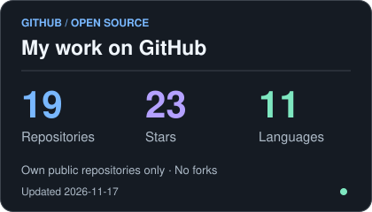
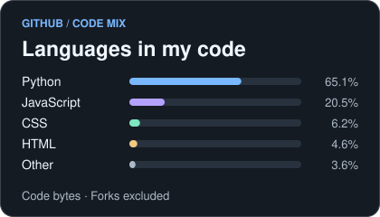

<a href="./README.md">Versión en español ↗</a>

# Martín Ferreira

**Final-year Ingeniería Civil Informática student (Computer Engineering)** 
Chile · Python · Software architecture · Artificial intelligence

I enjoy understanding how systems work and building clear, useful, maintainable solutions. My projects span backend development, web interfaces, automation, and AI integration; Python and software architecture are two of my main interests.

**Open to opportunities where I can contribute and grow within a technology team.**

[Contact](mailto:martin.f8@icloud.com) · [Projects](#selected-projects) · [Learning](#continuous-learning) · [Repositories](https://github.com/Martin-Ferreira-O?tab=repositories)

## On GitHub

  
  

The cards use real GitHub data. Language distribution describes public code, not proficiency.

## Technologies I work with

**Backend and integration:** Python, Django, FastAPI, HTTP APIs, WebSockets, SQL, and MongoDB. 
**Interfaces and tools:** React, JavaScript, TypeScript, Git, Docker, and Linux.

## Selected projects

### 01 / Psycode — Architecture, integration, and teamwork

A university team project supporting the supervision of psychology sessions. I have contributed to the backend, the interface, and the separation of the central server from the capture agent.

- **Architecture:** a Django backend organized into modules and layers, with an independent installable agent.
- **Integration:** a React interface, HTTP/WebSocket communication, and background audio processing.
- **Quality:** authentication, permissions, audit trails, integration tests, and component boundary checks.

`Python` `Django` `React` `MongoDB` `SQL` `WebSockets`

**Private repository** · [Read the technical case study →](./docs/psycode.en.md) · [Discuss the project](mailto:martin.f8@icloud.com?subject=Psycode)

### 02 / ML UFC — Data, models, and evaluation

A data pipeline and classification models for estimating fight outcome probabilities, with a Streamlit application.

- **Data and modeling:** features built from each fighter's prior history, using pandas and scikit-learn.
- **Evaluation:** temporal validation, baseline comparisons, and calibration and uncertainty analysis.
- **Engineering judgment:** documented model limitations and cases where it fails to outperform the market.

`Python` `pandas` `scikit-learn` `Streamlit`

[Explore the project and methodology →](https://github.com/Martin-Ferreira-O/ml-ufc)

### 03 / Cenital — A visual editor and a reusable component

A venue map editor and an embeddable interactive viewer for ticketing platforms. Zones and prices use a shared JSON contract.

- **Architecture:** the editor and viewer share validation, geometry, and SVG rendering.
- **Interaction:** zone selection, availability states, multiple floors, and keyboard navigation.
- **Integration:** a viewer with no runtime dependencies and an event interface for host applications.

`JavaScript` `SVG` `JSON` `CSS` `Accessibility`

[Explore the editor, viewer, and design decisions →](https://github.com/Martin-Ferreira-O/Cenital)

## More work

- **[Copero UFC](https://github.com/Martin-Ferreira-O/copero_ufc):** a React simulator with a JavaScript engine separate from the interface, seed-based reproducible runs, and balance and regression tests. **[Try the demo ↗](https://copero-ufc.vercel.app)**
- **[Claude Handoff Kit](https://github.com/Martin-Ferreira-O/claude-handoff-kit):** tools for preserving context and coordinating coding agents through file-based specifications and documented handoffs.

## Continuous learning

I complement university studies and project work with courses and reading on software design and artificial intelligence.

- **AI and tools:** free [Anthropic courses on Claude](https://academy.claude.com/) and additional coursework on Coursera.
- **Code and maintainability:** *Clean Code*, by Robert C. Martin.
- **Architecture in Python:** [*Architecture Patterns with Python*](https://www.cosmicpython.com/book/preface), by Harry Percival and Bob Gregory, focusing on TDD, DDD, and separation of responsibilities.

## Let's talk

I'm interested in working on real problems, learning from a team, and contributing through engineering judgment, curiosity, and experience building software.

**[martin.f8@icloud.com](mailto:martin.f8@icloud.com)**
