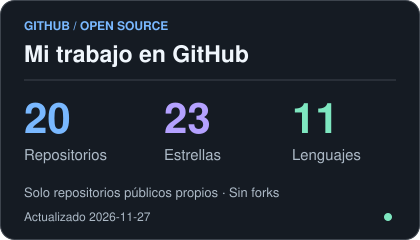
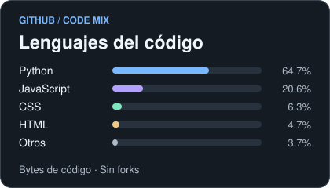

<a href="./README.en.md">English version ↗</a>

# Martín Ferreira

**Estudiante de último año de Ingeniería Civil Informática** 
Chile · Python · Arquitectura de software · Inteligencia artificial

Me gusta entender cómo funciona un sistema y construir soluciones claras, útiles y mantenibles. He trabajado en backend, interfaces web, automatización e integración de IA; Python y la arquitectura de software son dos de mis principales intereses.

**Abierto a oportunidades donde pueda aportar y seguir creciendo en un equipo de tecnología.**

[Contacto](mailto:martin.f8@icloud.com) · [Proyectos](#proyectos-destacados) · [Formación](#formación-continua) · [Repositorios](https://github.com/Martin-Ferreira-O?tab=repositories)

## En GitHub

  
  

Las tarjetas usan datos reales de GitHub. La distribución de lenguajes describe el código público, no un nivel de dominio.

## Tecnologías con las que trabajo

**Backend e integración:** Python, Django, FastAPI, APIs HTTP, WebSockets, SQL y MongoDB. 
**Interfaces y herramientas:** React, JavaScript, TypeScript, Git, Docker y Linux.

## Proyectos destacados

### 01 / Psycode — Arquitectura, integración y trabajo en equipo

Proyecto universitario en equipo para apoyar la supervisión de sesiones de psicología. He contribuido al backend, a la interfaz y a la separación entre el servidor central y el agente de captura.

- **Arquitectura:** backend Django organizado por módulos y capas, con un agente instalable independiente.
- **Integración:** interfaz React, comunicación HTTP/WebSocket y procesamiento de audio en segundo plano.
- **Calidad:** autenticación, permisos, trazabilidad y pruebas de integración y de límites entre componentes.

`Python` `Django` `React` `MongoDB` `SQL` `WebSockets`

**Repositorio privado** · [Leer el caso técnico →](./docs/psycode.md) · [Conversar sobre el proyecto](mailto:martin.f8@icloud.com?subject=Psycode)

### 02 / ML UFC — Datos, modelos y evaluación

Pipeline de datos y modelos de clasificación para estimar probabilidades de resultados de peleas, con una aplicación en Streamlit.

- **Datos y modelado:** variables construidas a partir del historial previo de cada pelea, con pandas y scikit-learn.
- **Evaluación:** validación temporal, comparación con baselines y análisis de calibración e incertidumbre.
- **Criterio técnico:** documentación de los límites del modelo y de los casos en que no supera al mercado.

`Python` `pandas` `scikit-learn` `Streamlit`

[Explorar el proyecto y su metodología →](https://github.com/Martin-Ferreira-O/ml-ufc)

### 03 / Cenital — Un editor visual y un componente reutilizable

Editor de mapas de recintos y visor interactivo embebible para plataformas de venta de entradas. Las zonas y los precios se describen mediante un contrato JSON compartido.

- **Arquitectura:** editor y visor comparten validación, geometría y renderizado SVG.
- **Interacción:** selección de zonas, estados de disponibilidad, múltiples pisos y navegación por teclado.
- **Integración:** visor sin dependencias de ejecución, con eventos para conectarlo a una aplicación anfitriona.

`JavaScript` `SVG` `JSON` `CSS` `Accesibilidad`

[Ver el editor, el visor y las decisiones de diseño →](https://github.com/Martin-Ferreira-O/Cenital)

## También he construido

- **[Copero UFC](https://github.com/Martin-Ferreira-O/copero_ufc):** simulador en React con un motor JavaScript separado de la interfaz, partidas reproducibles por semilla y pruebas de balance y regresión. **[Probar demo ↗](https://copero-ufc.vercel.app)**
- **[Claude Handoff Kit](https://github.com/Martin-Ferreira-O/claude-handoff-kit):** herramientas para conservar contexto y coordinar agentes de programación mediante especificaciones y entregas documentadas.

## Formación continua

Complemento la universidad y los proyectos con cursos y lectura sobre diseño de software e inteligencia artificial.

- **IA y herramientas:** cursos gratuitos de [Anthropic sobre Claude](https://academy.claude.com/) y formación complementaria en Coursera.
- **Código y mantenibilidad:** *Clean Code*, de Robert C. Martin.
- **Arquitectura en Python:** [*Architecture Patterns with Python*](https://www.cosmicpython.com/book/preface), de Harry Percival y Bob Gregory, con foco en TDD, DDD y separación de responsabilidades.

## Conversemos

Me interesa trabajar en problemas reales, aprender de un equipo y aportar con criterio técnico, curiosidad y experiencia construyendo software.

**[martin.f8@icloud.com](mailto:martin.f8@icloud.com)**
